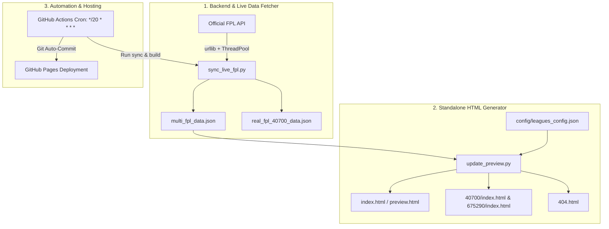

# FPL Mini-League Presentation Dashboard: Project Context & Architecture

> **เอกสารสรุปบริบทโปรเจกต์ (Project Blueprint & Single Source of Context)**
> บันทึกสถานะปัจจุบัน โครงสร้างระบบ สถาปัตยกรรม และประวัติการพัฒนาจากทุกแชท เพื่อให้ AI และผู้พัฒนาในทุก Session เข้าใจภาพรวมได้ทันที 100%

---

## 📌 1. ภาพรวมโปรเจกต์ (Project Overview)
โปรเจกต์นี้เป็น **Fantasy Premier League (FPL) Mini-League Presentation & Analytics Dashboard** ที่ออกแบบมาเพื่อแฟนตาซีมินิลีก (ฤดูกาล 2026/27) นำเสนอข้อมูลแบบ Real-time Live & Historical พร้อมระบบคำนวณเงินรางวัล, Hall of Fame, ผังผู้เล่น 11 ตัวจริง (Authentic Pitch), และระบบบทวิเคราะห์แชมป์ประจำสัปดาห์สไตล์ **"บอ.บู๋" (Borbou Commentary Engine)**

* **Production URL:** `https://asawamanasak.github.io/fpl-mini/`
* **Direct League URLs:**
  * ลีก 40700 (เซียนอยู่รู หมูอยู่ตึก): `https://asawamanasak.github.io/fpl-mini/40700`
  * ลีก 675290 (NudNee): `https://asawamanasak.github.io/fpl-mini/675290`
  * ลีก 38491 (รอ แมน โอน): `https://asawamanasak.github.io/fpl-mini/38491`
  * ลีก 1101958 (Barley's Official League): `https://asawamanasak.github.io/fpl-mini/1101958`
  * ลีก 438691 (2 spade): `https://asawamanasak.github.io/fpl-mini/438691`
  * ลีก 187827 (Shi62): `https://asawamanasak.github.io/fpl-mini/187827`
  * ลีก 5349 (Bramann League): `https://asawamanasak.github.io/fpl-mini/5349`
  * ลีก 567387 (Fantasy Nguan & friends cup): `https://asawamanasak.github.io/fpl-mini/567387`
* **Repository:** `https://github.com/asawamanasak/fpl-mini`

---

## 🏗️ 2. สถาปัตยกรรมระบบ (System Architecture)

ระบบแบ่งออกเป็น 3 เลเยอร์หลัก:



---

## 📁 3. โครงสร้างไฟล์ในโปรเจกต์ (File Directory Map)

```
/Users/micky/Desktop/FPL เซียนอยู่รู/
├── .github/
│   └── workflows/
│       └── fpl_auto_sync.yml     # GitHub Actions รัน Auto-Sync ทุก 20 นาที
├── config/
│   ├── leagues_config.json       # ไฟล์ตั้งค่ามินิลีก (ID, ชื่อลีก, กติการางวัล)
│   └── shi62_special.txt         # ไฟล์บันทึกข้อมูลมินิเกม Shi'62 Special รายสัปดาห์
├── fonts/
│   ├── SukhumvitSet-Bold.ttf
│   ├── SukhumvitSet-Medium.ttf
│   ├── SukhumvitSet-SemiBold.ttf
│   └── SukhumvitSet-Text.ttf     # ฟอนต์พรีเมียม Sukhumvit Set ภาษาไทย
├── images/
│   └── fpl-logo.jpg              # โลโก้ FPL ประจำหัวเว็บ
├── js/ (Modular Core for Local Dev)
│   ├── api.js                   # API Fetcher & Fallback Proxy
│   ├── app.js                   # App Controller
│   ├── calculator.js            # สูตรคำนวณแต้มสุทธิ (หัก Hits), สถิติ Hall of Fame
│   ├── config.js                # ค่าคอนฟิกลีก 40700
│   ├── mockData.js              # ข้อมูลออฟไลน์สำรอง
│   ├── share.js                 # ฟังก์ชันคัดลอกสรุปผลส่ง LINE
│   ├── taglines.js              # เครื่องมือสร้างคำคมแชมป์
│   └── ui.js                    # UI Rendering Engine
├── css/
│   └── styles.css               # สไตล์ CSS และสนามฟุตบอล
├── 40700/index.html             # Entrypoint ตรงสำหรับลีก 40700
├── 675290/index.html            # Entrypoint ตรงสำหรับลีก 675290
├── 38491/index.html             # Entrypoint ตรงสำหรับลีก 38491
├── 404.html                     # รองรับ Single-Page Routing บน GitHub Pages
├── index.html                   # หน้า Dashboard หลัก (Standalone Bundle)
├── preview.html                 # หน้า Preview ในเครื่อง
├── multi_fpl_data.json          # ไฟล์ข้อมูลรวมทุกมินิลีก (Data Hub)
├── real_fpl_40700_data.json     # ไฟล์ข้อมูลย้อนหลังเฉพาะลีก 40700
├── sync_live_fpl.py             # สคริปต์ Python ดึงข้อมูลสดจาก Official FPL API
├── parse_shi62_special.py       # ระบบ Parser & คำนวณเงินรางวัลมินิเกม Shi'62 Special
├── update_preview.py            # สคริปต์คอมไพล์ Standalone HTML ทุกมินิลีก
├── PROJECT_CONTEXT.md           # [ไฟล์นี้] สรุปพิมพ์เขียวโปรเจกต์ทั้งหมด
└── README.md                    # เอกสารแนะนำและกติกา
```

---

## ⚙️ 4. รายละเอียดมินิลีกและกติกา (League Rules & Configs)

ข้อมูลถูกควบคุมผ่าน `config/leagues_config.json`:

### ลีก 1: 40700 - "เซียนอยู่รู หมูอยู่ตึก"
* **สมาชิก:** 12 ทีม
* **งบประมาณรางวัลรวม:** **22,000 บาท**
* **โครงสร้างรางวัล:**
  1. **แชมป์ประจำสัปดาห์ (Weekly Champ):** 350 บาท x 38 สัปดาห์ = 13,300 บาท
  2. **แชมป์ฟุตบอลถ้วย (Cup Tournament):** แชมป์ 1,000 บาท / รองแชมป์ 650 บาท = 1,650 บาท
  3. **แชมป์คะแนนรวมฤดูกาล (Season Overall):** อันดับ 1 (3,500 บ.), อันดับ 2 (2,000 บ.), อันดับ 3 (1,000 บ.), อันดับ 4 (550 บ.) = 7,050 บาท
* **รอบเคลียร์เงิน 6 Phase:**
  * Phase 1 (GW 1-6), Phase 2 (GW 7-12), Phase 3 (GW 13-18), Phase 4 (GW 19-24), Phase 5 (GW 25-30), Phase 6 (GW 31-38 + บอลถ้วย + แชมป์ลีก)

### ลีก 2: 675290 - "NudNee"
* **สมาชิก:** 59 ทีม
* **งบประมาณรางวัลรวม:** **36,000 บาท** (พร้อมสมทบเพิ่มหากมีผู้ลงเล่นประจำเดือนเพิ่ม)
* **โครงสร้างรางวัล:** 
  1. **รางวัลคะแนนรวมประจำฤดูกาล (Season Overall):** รวม 13,500 บาท
     * อันดับ 1 : 5,000 บาท
     * อันดับ 2 : 3,500 บาท
     * อันดับ 3 : 2,500 บาท
     * อันดับ 4 : 1,500 บาท
     * อันดับ 5 : 1,000 บาท
  2. **รางวัลประจำเดือน (Monthly Prizes):** 10 เดือน (ส.ค. 2026 - พ.ค. 2027) รวม 10,000 บาท
     * แชมป์ประจำเดือน : 600 บาท / เดือน (รวม 6,000 บาท)
     * รองแชมป์ประจำเดือน : 400 บาท / เดือน (รวม 4,000 บาท)
  3. **แชมป์ฟุตบอลถ้วย (Cup Champion):** 3,000 บาท (วัดผลสำหรับคนที่ลุ้นรางวัล ถ้าตกรอบเดียวกัน ให้คนที่คะแนนสูงกว่าชนะ)
  4. **ยอดเงินบริจาคการกุศล (Charity Donation):** 9,500 บาท (บริจาคทำบุญให้แก่โรงพยาบาล)
  * *หมายเหตุ: เงินรางวัลอาจมีการเพิ่มเติม ถ้าในระหว่างสิบเดือนของฤดูกาล มีผู้ลงเล่นประจำเดือน*

### ลีก 3: 38491 - "รอ แมน โอน"
* **สมาชิก:** 15 ทีม
* **ค่าสมัคร:** 1,900 บาท/ทีม (50 บาท x 38 สัปดาห์)
* **งบประมาณรางวัลรวม:** **28,500 บาท**
* **การบริหารกองกลาง:** เก็บงวดเดียวเต็มจำนวน 1,900 บาท/ทีม โดยมี "เฟม" (Some might say) เป็นผู้ประสานงานและดูแลเงินกองกลาง
* **โครงสร้างรางวัล:**
  1. **แชมป์ประจำสัปดาห์ (Weekly Champ):** 500 บาท x 38 สัปดาห์ = 19,000 บาท (หักแต้มย้าย Hits, หากแต้มเท่ากันหารรางวัลเท่ากัน)
  2. **แชมป์คะแนนรวมฤดูกาล (Season Overall):** รวม 9,500 บาท
     * อันดับ 1: 4,500 บาท
     * อันดับ 2: 2,500 บาท
     * อันดับ 3: 1,000 บาท
     * อันดับ 4 - 5: อันดับละ 500 บาท
  3. **แชมป์ลีคคัพ (Mini-League Cup):** 1,000 บาท (เริ่มแข่งขันรอบ Knockout ใน Gameweek 35 เฉพาะทีมที่ชำระค่าสมัคร)

### ลีก 4: 1101958 - "Barley's Official League"
* **สมาชิก:** 17 ทีม (12 ทีมชิงเงินรางวัล + 5 ทีมร่วมสนุก)
  * **ทีมชิงเงินรางวัล (12 ทีม):** BMFC™, Oöraora Grandé, Jazzzmith, Ekamai United, Natthapol's Team (Golffu), NuttChan, Univerpool, RJarnOat, เถลิงบัลลังก์แชมป์, BoomBaraka, The AI era, ทีมระบบครับ
  * **ทีมร่วมสนุก (5 ทีม):** GEMINI UNITED, worawolf, pae takam, TUNBO CHICKEN RICE, AI Boys
* **ค่าสมัคร:** รายวีค 200 THB x 38 วีค (7,600 THB) + รายปี 1,000 THB = รวม 8,600 THB / ทีม
* **งบประมาณรางวัลรวม:** **103,200 บาท** (คำนวณจาก 12 ทีมชิงรางวัล: รายวีค 91,200 THB + รายปี 12,000 THB)
* **โครงสร้างรางวัล:**
  1. **รางวัลประจำสัปดาห์ (Top 3 Weekly Prizes):** รวม 2,400 บาท / สัปดาห์ (38 สัปดาห์ รวม 91,200 บาท)
     * อันดับ 1: 1,200 บาท / วีค
     * อันดับ 2: 720 บาท / วีค
     * อันดับ 3: 480 บาท / วีค
     * *กรณีคะแนนสุทธิเท่ากัน (Tie-breaker):* ตัดสินด้วยทีมที่มีตัวทำแต้มสูงสุด (Highest Scoring Player) ในสัปดาห์นั้น หากยังเท่ากันให้ดูตัวทำแต้มสูงสุดอันดับถัดไปทีละคนจนกว่าจะหาผู้ชนะได้ (หากตัวทำแต้มเท่ากันหมดทุกตัวจึงหารรางวัลเท่ากัน)
  2. **รางวัลประจำฤดูกาล (Season Overall Top 3):** รวม 12,000 บาท
     * อันดับ 1: 6,000 บาท
     * อันดับ 2: 3,600 บาท
     * อันดับ 3: 2,400 บาท

### ลีก 5: 438691 - "2 spade"
* **สมาชิก:** 13 ทีม (12 ทีมชิงรางวัล & จ่ายค่าปรับ + 1 ทีมร่วมสนุก)
  * **ทีมชิงรางวัล (12 ทีม):** BMFC™, MFV F.C., Natthapol's Team, ทีมของ Thanakorn, Kafare, TopPP FC, Shoot FC, JOEYMON #10, H, RJarnOat, suriya's Team, KFC
  * **ทีมร่วมสนุก (1 ทีม):** GEMINI UNITED (ID: 306983)
* **ค่าสมัคร:** ไม่มีค่าสมัครแรกเข้า (ใช้ระบบค่าปรับ 5 อันดับท้ายสะสมเข้ากองกลาง)
* **งบประมาณกองกลางสะสมสุทธิ:** **68,400 บาท** (สุทธิ 1,800 บาท / วีค x 38 สัปดาห์)
* **โครงสร้างรางวัล & ค่าปรับ:**
  1. **รางวัลแชมป์ประจำสัปดาห์ (Weekly Winner):** 200 บาท / สัปดาห์ (หักจากเงินค่าปรับประจำสัปดาห์ 2,000 บาท)
  2. **ค่าปรับ 5 อันดับสุดท้ายจากบ๊วย (Weekly Fines into Central Pool):** รวม 2,000 บาท / สัปดาห์
     * อันดับสุดท้าย (บ๊วย): เสียค่าปรับ 600 บาท
     * รองบ๊วย (อันดับ 2 จากท้าย): เสียค่าปรับ 500 บาท
     * อันดับ 3 จากท้าย: เสียค่าปรับ 400 บาท
     * อันดับ 4 จากท้าย: เสียค่าปรับ 300 บาท
     * อันดับ 5 จากท้าย: เสียค่าปรับ 200 บาท
     * *(อันดับ 2 ถึง 7 ปลอดภัย ไม่เสียค่าปรับ)*
  3. **การสะสมเข้ากองกลาง:** เงินค่าปรับ 2,000 บาท หักรางวัลที่ 1 (200 บาท) เหลือสะสมเข้ากองกลางสุทธิ 1,800 บาท / สัปดาห์ (38 สัปดาห์ รวม 68,400 บาท)
  4. **กติกา Tie-breaker:** ตัดสินด้วยทีมที่มีตัวทำแต้มสูงสุด (Highest Scoring Player) ในสัปดาห์นั้น หากยังเท่ากันให้ดูตัวทำแต้มสูงสุดอันดับถัดไปทีละคน (หากเท่ากันหมดทุกตัวจึงหารรางวัลหรือเฉลี่ยค่าปรับ)

### ลีก 6: 187827 - "Shi62"
* **สมาชิก:** 13 ทีม (12 ทีมชิงรางวัล & ร่วมจ่ายค่าปรับ + 1 ทีมร่วมสนุก)
  * **ทีมชิงรางวัล (12 ทีม):** amornTong, Oöraora Grandé, Riin FC, Totti Toon Army, The Cannon, Benjamin Seskooan, SiaLeela, Emery's Revenge, Carrickysseus, Bruno carrick, Bluebert's Team, Winwinwin
  * **ทีมร่วมสนุก (1 ทีม):** GEMINI UNITED (ID: 306983)
* **ค่าสมัคร:** จ่ายตามผลอันดับสิ้นฤดูกาล (อันดับ 7-12 จ่ายให้อันดับ 1-6)
* **งบประมาณรวมแบบ Zero-Sum:** **3,100 บาท** (ไม่มีเงินกองกลางค้าง เคลียร์จ่ายทีเดียวหลังจบ GW 38)
* **โครงสร้างรางวัล & ค่าปรับ (คะแนนรวมรายปี จ่ายตังทีเดียว):**
  1. **กลุ่มผู้ได้รับเงินรางวัล (อันดับ 1 - 6 รวม +3,100 บาท):**
     * อันดับ 1 (แชมป์ลีก): ได้รับ +1,000 บาท
     * อันดับ 2: ได้รับ +800 บาท
     * อันดับ 3: ได้รับ +600 บาท
     * อันดับ 4: ได้รับ +400 บาท
     * อันดับ 5: ได้รับ +200 บาท
     * อันดับ 6: ได้รับ +100 บาท
  2. **กลุ่มผู้ร่วมจ่ายเงินค่าปรับ (อันดับ 7 - 12 รวม -3,100 บาท):**
     * อันดับ 7: จ่าย -100 บาท
     * อันดับ 8: จ่าย -200 บาท
     * อันดับ 9: จ่าย -400 บาท
     * อันดับ 10: จ่าย -600 บาท
     * อันดับ 11: จ่าย -800 บาท
     * อันดับ 12 (บ๊วย): จ่าย -1,000 บาท
  3. **ทีมร่วมสนุก:** GEMINI UNITED ไม่ได้รับเงินรางวัลและไม่ร่วมจ่ายเงินค่าปรับ (แสดงผลร่วมสนุกอย่างเดียว)
  4. **การตัดสิน:** ตัดสินจากคะแนนสะสมสุทธิหลังจบการแข่งขัน GW 38 ครบถ้วน หากคะแนนรวมเท่ากัน ตัดสินตามระบบทางการของ FPL (คะแนนรวม -> ประตูได้ -> ประตูเสีย)
* **มินิเกมพิเศษประจำสัปดาห์: 'Shi\'62 Special' (แท็บเฉพาะลีก 187827):**
  * **ผู้เล่น:** สมาชิกในลีก 187827 (ยกเว้น GEMINI UNITED) พร้อมผู้ร่วมทายผลเฉพาะมินิเกม ('Nod' ซึ่งไม่ได้ลงเล่นแฟนตาซี FPL)
  * **รูปแบบ:** ทายผลฟุตบอลพรีเมียร์ลีกพร้อมแต้มต่อ (Handicap) รายคู่ในแต่ละ Gameweek
  * **กติกาได้-เสีย (Peer-to-Peer Zero-Sum):**
    * แทงผิดเสียขาละ 100 บาทต่อคู่
    * เงินกองกลางของคนที่แทงผิดจะถูกนำมาหารเฉลี่ยให้ผู้ที่ทายช่องถูกทุกคนเท่ากัน
    * หากมีเศษปัดให้คนที่มีชื่อแรกสุดในช่องถูกได้มากกว่า 5 หรือ 10 บาท (เช่น เสีย 200 บาท / ชนะ 3 คน -> คนแรกได้ 70 บาท, อีกสองคนได้คนละ 65 บาท)
    * หากคู่นั้นไม่มีใครทายถูกเลย ถือเป็นโมฆะ (Push / เจ๊า) ไม่มีใครได้และไม่มีใครเสียเงิน
  * **ช่องทางอัปเดตข้อมูล:** ผ่านไฟล์ข้อความ `config/shi62_special.txt` โดยวางบันทึกย่อคู่แข่งขันและผลชนะได้โดยตรง ระบบมี Parser คำนวณเงินและอัปเดตเว็บให้อัตโนมัติ
  * **การแสดงผล:** แท็บเฉพาะ (ปัจจุบันตั้งชื่อชั่วคราวว่า 'BETA') ประกอบด้วยสถิติภาพรวม, ตารางเงินสะสมตลอดฤดูกาล, ตัวเลือกดูย้อนหลังรายสัปดาห์ (GW Selector), การ์ดแจกแจงผลรายคู่ (แสดงชื่อทีมเต็มและผลเสมอ เช่น `BRE`, `draw`, `LIV` แทนตัวย่อตัวเดียว), และปุ่มคัดลอกสรุปผลส่ง LINE
  * **รายชื่อทีมและตัวย่อในมินิเกม (12 ทีม FPL + 1 Guest):**
    * `Tong`: amornTong (Amornthep Taveephanich)
    * `Oo`: Oöraora Grandé (Patrick Oo)
    * `Riin`: Riin FC (WARIN SINAROJ)
    * `Totti`: Totti Toon Army (Totti NUFC)
    * `Poang`: The Cannon (Kasidit Boonyawat)
    * `Oan`: Benjamin Seskooan (Nattaporn Yaemsaard)
    * `Sia`: SiaLeela (Prachya Leelamantep)
    * `Mai`: Emery's Revenge (Rati Leetrakul)
    * `Boy`: Carrickysseus (Thamrong Pattarajiarapan)
    * `Bert`: Bluebert's Team (Bluebert Tingnongnoi)
    * `Pong+`: Winwinwin (Ratapan W)
    * `Dow`: Bruno Carrick (Bruno Zoro)
    * `Nod`: ผู้ร่วมทายผล (เล่นเฉพาะมินิเกม ไม่ได้ลงเล่นแฟนตาซี FPL)

### ลีก 7: 5349 - "Bramann League"
* **สมาชิก:** 20 ทีม (19 ทีมแข่งขัน + 1 ทีมร่วมสนุก GEMINI UNITED)
  * **ทีมร่วมสนุก (1 ทีม):** GEMINI UNITED (ID: 306983)
  * **สมาชิกแข่งขัน (19 ทีม):** -Nk_KOP, Oöraora Grandé, van Xke, BMFC™, Putun KNVB, Micchester United, 4OUR, NUKE-UTD®, CasanoVej, Univerpool, Falco.245, Talidtidty, KwangSettha, HereAu, golden club, Pongacku, Dotman 2026, 67, Supalerk's Team
* **สถานะกติกา & เงินรางวัล:** อยู่ระหว่างรอประกาศกติกาและโครงสร้างเงินรางวัลอย่างเป็นทางการ (Pending Rules & Prizes)
* **Direct League URL:** `https://asawamanasak.github.io/fpl-mini/5349`

### ลีก 8: 567387 - "Fantasy Nguan & friends cup"
* **สมาชิก:** 12 ทีม
  * **สมาชิก:** GEMINI UNITED, Punizio, ATikom, LARPWAHAHA FC, bomb29599, Attack The Champion, Pokko Utd, The Red Company, FAKETHIS, Inwza007, and others
* **สถานะกติกา & เงินรางวัล:** อยู่ระหว่างรอผู้ดูแลลีกประกาศกติกาและโครงสร้างเงินรางวัล (Pending Rules & Prizes)
* **Direct League URL:** `https://asawamanasak.github.io/fpl-mini/567387`

---

## 🎨 5. ไฮไลต์ฟีเจอร์สำคัญด้าน UI/UX & Frontend

1. **Standalone Single-File Distribution (`update_preview.py`):**
   - รวม HTML, Tailwind CSS (CDN), Chart.js (CDN), และ Multi-League Data JSON ไว้ในไฟล์เดียว
   - ตัดปัญหา CORS 100% รันได้ทันทีทั้ง Local (file://) และ GitHub Pages
2. **Authentic Pitch Formation & Official FPL Club Kits:**
   - ผังสนามฟุตบอล 4 ชั้น (GK, DEF, MID, FWD) พร้อมม้านั่งสำรอง
   - แสดงเสื้อแข่งจริงของสโมสร (Official FPL Kits) ทั้งเสื้อผู้เล่นเหย้าและเสื้อผู้รักษาประตู พร้อมเซฟเป็น Local Assets ใน `images/shirts/`
   - มี Badge แสดง Captain (C), Vice-Captain (V), และชิป (3xC, Bench Boost, Free Hit, Wildcard)
3. **Borbou Commentary Engine (ระบบวิเคราะห์สไตล์ บอ.บู๋):**
   - **กฎเหล็ก:** **งดใช้อีโมจิ 100%**, ใช้สำนวนดุดัน กวน ขยี้ ปากจัด แบบคอลัมนิสต์รุ่นเก๋า
   - **Century Club:** มีคำคมพิเศษเฉพาะสำหรับทีมที่ทำแต้มทะลุ 100+ คะแนนในสัปดาห์เดียว
   - **Customizable Note:** แอดมินสามารถพิมพ์แก้ไขบทวิเคราะห์สดได้บนหน้าเว็บ
4. **Instant LINE Copy:**
   - ปุ่มคัดลอกสรุปผลคะแนน ตารางอันดับ และเงินรางวัล เพื่อนำไปวางในกลุ่มแชท LINE ได้ทันที
5. **Visitor Counter Badge:**
   - แสดงยอดผู้เข้าชมเว็บไซต์แบบเรียลไทม์ที่ Footer ดีไซน์มินิมอลสีเทา `Visitors: xxxx`
   - เชื่อมต่อกับ `api.visitorbadge.io` แบบ Serverless พร้อมระบบ Cache บน `localStorage` ป้องกันหน้ากระตุก
   - **Anti-Spam / Cooldown Lock:** ล็อกคูลดาวน์ 1 ชั่วโมงต่อบราวเซอร์ ป้องกันยอดเฟ้อจากการกด Refresh (F5) หรือสลับแท็บไปมา
6. **Competition View (ภาพรวมการแข่งขัน & ข้อมูลเชิงลึก):**
   - อยู่ระหว่างแท็บ **Weekly Highlight** และ **สรุปรางวัล** รองรับข้อมูลแบบไดนามิกตามมินิลีกที่ผู้ใช้เลือก (Dynamic Multi-League Integration)
   - **Card Available:** ตารางวิเคราะห์ชิป/การ์ดคงเหลือของทุกทีมในลีก (WC1, WC2, FH, 3xC, BB) พร้อมการ์ดสรุปยอดคงเหลือของทั้งลีก ช่วยให้ประเมินการ์ดคู่แข่งได้ทันที
   - **Important Players (> 70%):** แสดงนักเตะมหาชนที่ถูกเลือกเกิน 70% ในลีก พร้อม % ถือครอง, จำนวนทีม และรายชื่อทีมที่เลือก
   - **Differential Players (< 20%):** แสดงนักเตะทีเด็ดที่ถูกเลือกน้อยกว่า 20% ในลีก พร้อมฟิลเตอร์แยกตำแหน่ง (GKP, DEF, MID, FWD) และแท็กแสดงชื่อทีมที่เป็นเจ้าของ
   - **Transfer Suggestions:** คำแนะนำการย้ายตัวประจำสัปดาห์ (Best Players & Best Value) จาก FPL Gameweek พร้อม Projected Points, % ถือครองในลีก และระบบดร็อปดาวน์ไฮไลท์นักเตะในทีมตนเอง (Bold + Badge ในทีม)

---

## 🔄 6. ระบบ Backend & GitHub Actions Sync

1. **สคริปต์ `sync_live_fpl.py`:**
   - ใช้ `ThreadPoolExecutor(max_workers=10)` ดึงข้อมูล Picks, Live Points, Sub, Captain ของทุกทีมพร้อมกัน
   - ดึงข้อมูลจาก:
     - `/api/bootstrap-static/` (รายชื่อนักเตะ, ทีม, สถานะ GW)
     - `/api/event/{gw}/live/` (แต้มสดและโบนัส BPS)
     - `/api/leagues-classic/{lid}/standings/` (ตารางอันดับลีก)
     - `/api/entry/{eid}/event/{gw}/picks/` (11 ตัวจริง, ตัวสำรอง, กัปตัน, Hits, ชิป)
   - คำนวณ Net Points = `Raw Points - Transfer Cost (Hits)` อย่างแม่นยำ
2. **การทำงานของ GitHub Actions Workflow (`fpl_auto_sync.yml`):**
   - Trigger: รันอัตโนมัติทุกๆ 20 นาที (`cron: '*/20 * * * *'`) หรือกดรันมือได้ (`workflow_dispatch`)
   - ขั้นตอน: Checkout -> Python 3.11 -> `python3 sync_live_fpl.py` -> `python3 update_preview.py` -> Auto Commit & Push `[skip ci]`

---

## 🔍 7. ปัญหาที่พบบ่อยและข้อสังเกตทางเทคนิค (Technical Insights)

### เรื่อง: สถานะ Gameweek แสดงเป็น `LIVE` แม้เตะจบครบทุกคู่แล้ว
* **สาเหตุ:** ทาง Official FPL Server ใช้เวลาประมาณ 8–18 ชั่วโมงหลังเกมนัดสุดท้ายจบ เพื่อรัน Batch ตรวจสอบข้อมูลระดับโลก (`data_checked`) ก่อนจะสลับค่า `finished: true` ใน `/api/bootstrap-static/`
* **แนวทางแก้ไขล่วงหน้า:** สามารถปรับให้ `sync_live_fpl.py` ตรวจสอบสถานะจาก `/api/fixtures/?event=X` หากทุกคู่ขึ้น `finished = true` หรือ `finished_provisional = true` ครบ 10 คู่ ให้ปรับ `is_finished = true` ให้อัตโนมัติทันที

### เรื่อง: การกดดูแผนจัดทีมเปิดไม่ติดในทีมที่มีเครื่องหมายคำพูด (Quote-Safety)
* **สาเหตุ:** ชื่อทีมที่มีเครื่องหมาย `'` เช่น `Ziang's Team` หรือ `Chatiwat's Team` ทำให้ inline `onclick` string attribute ถูกตัดสตริงและเกิด JS SyntaxError
* **แนวทางแก้ไขที่เสร็จสิ้น:** ปรับให้ส่งเฉพาะ `entry_id` (Number) เท่านั้น และค้นหาข้อมูลจาก JSON Object โดยตรง พร้อมเพิ่มการจัดการกรณีไม่มีข้อมูลแผนในสัปดาห์นั้นให้แสดงกล่องว่างแบบสวยงาม (Graceful Empty State) แทนการดึงข้อมูลทีมอื่นมาแสดง

### เรื่อง: การบันทึกไฟล์อัตโนมัติใน GitHub Actions (`.github/workflows/fpl_auto_sync.yml`)
* **จุดที่ตรวจพบ:** บรรทัดที่ 39 ในไฟล์ workflow เดิมมีคำสั่ง `git add real_fpl_40700_data.json index.html preview.html` ซึ่งข้ามการบันทึก `multi_fpl_data.json` และหน้าลีกลำดับอื่น (`40700/index.html`, `675290/index.html`, `38491/index.html`, `404.html`)
* **วิธีแก้ไข:** แนะนำให้กด Edit ไฟล์ `.github/workflows/fpl_auto_sync.yml` บนหน้าเว็บ GitHub โดยเปลี่ยนบรรทัดที่ 39 เป็น `git add -A` เพื่อให้ระบบ Auto Sync ทุก 20 นาทีบันทึกและอัปเดตไฟล์ของทุกลีกขึ้นสู่เว็บอย่างสมบูรณ์แบบ


### เรื่อง: ฟังก์ชัน Competition (ข้อมูลเจาะลึกคู่แข่ง & การวิเคราะห์ขุมกำลัง)
* **ตำแหน่งเมนู:** อยู่ระหว่าง `Weekly Highlight` และ `สรุปรางวัล`
* **ฟีเจอร์ภายใน:**
  1. **Card Available:** ตารางและ Matrix แสดงการ์ดคงเหลือของทุกทีมในลีก (WC1, FH, 3xC, BB) โดยซ่อน WC2 จนกว่าจะถึง GW20 พร้อมฟิลเตอร์ Active State และ Sticky Column สำหรับจอมือถือ
  2. **Important Players:** รายชื่อนักเตะยอดนิยมที่ถูกเลือกมากกว่า 70% พร้อมระบุจำนวนทีมและ %
  3. **Differential Players:** รายชื่อตัวทีเด็ดดิฟเฟอเรนเชียลที่ถูกเลือกน้อยกว่า 20%
  4. **Transfer Suggestions:** แนะนำการย้ายทีม (Best Players / Best Value) รายตำแหน่ง อ้างอิงจาก AI Algorithm พร้อมไฮไลต์ทีมในลีกตามลำดับ Total Leaderboard
* **ระบบการกระพริบของแท็บเมนู (Tab Blinking Logic):**
  * **ขณะเกมวีคกำลังแข่งขัน (`is_finished = false`):** แท็บ `LIVE` และ `Weekly Highlight` กระพริบสีเขียว เพื่อดึงดูดให้ผู้ใช้ติดตามผลสด ส่วนแท็บ `Competition` หยุดกระพริบ
  * **เมื่อจบการแข่งขันเกมวีคนั้นแล้ว (`is_finished = true`):** แท็บ `LIVE` และ `Weekly Highlight` หยุดกระพริบ ส่วนแท็บ `Competition` จะขึ้นกระพริบแทน เพื่อเตือนให้ผู้จัดการทีมเข้ามาดูการ์ดคู่แข่งและวางแผนย้ายตัวก่อนเกมวีคถัดไปจะเริ่ม
* **การจัดเรียงลำดับทีม (Team Ordering & Non-prize Separation):**
  * ทีมที่แข่งขันชิงเงินรางวัลจะถูกจัดเรียงตามลำดับ Total Leaderboard (อันดับ 1, 2, 3...) อยู่ด้านบน
  * ทีมร่วมสนุก (`non_prize_teams`) จะถูกแยกนำไปไว้ด้านล่างทั้งหมด คั่นด้วยแถบหัวข้อ `ทีมร่วมสนุก (ไม่นำมาคิดคำนวณเงินรางวัล)` พร้อมแสดงป้าย `[ ร่วมสนุก ]` และสัญลักษณ์วงกลมแบบไม่มีตัวเลขอันดับ เช่นเดียวกับหน้าสรุปรางวัล
* **ระบบจัดการคะแนนนักเตะที่ยังไม่ได้ลงแข่งขัน (Unstarted Players Points UI/UX):**
  * ในเกมวีคที่กำลังแข่งขันอยู่ (`is_finished = false`) หากนักเตะคู่ใดยังไม่ได้เริ่มแข่งขัน (`not_played_yet = true` หรือยังไม่ Kickoff) ระบบจะไม่แสดงคะแนน `0 pts` ในหน้าสนามจัดทัพ (Squad Pitch Modal) เพื่อให้ผู้ใช้ทราบชัดเจนว่านักเตะยังมีโอกาสลงสนามทำคะแนนอยู่
  * สำหรับผู้เล่นตัวสำรองที่ยังไม่ได้ลงแข่งขัน จะแสดงเครื่องหมาย `-` แทนตัวเลข `0 pts` และไม่นับรวมเป็นผลรวมคะแนนบนม้านั่งสำรองจนกว่าจะเริ่มเตะ


---

## 🚀 8. แนวทางการพัฒนาต่อยอดในอนาคต (Roadmap & Scaling Architecture)

### 8.1 สถาปัตยกรรมรองรับการขยายตัวบน GitHub Free Tier (Micro-SaaS Ready)
1. **Tiered League Architecture (การแยกเกรดของลีก) - [ACTIVE & VERIFIED]:**
   * **Tier 1: Mini-League (1 – 30 ทีม):**
     * โหมด Full Analytics & Pitch View (ดึง Picks, 11 ตัวจริง, ตัวสำรอง, กัปตัน, Hits, ชิป, สถิติเงินรางวัล)
     * รองรับได้สูงสุด ~20 – 30 ลีก (300 – 500 ทีมรวม) ต่อรอบการรัน เพื่อไม่ให้ชน Rate Limit 429 ของ FPL
   * **Tier 2: Large League (31 – 1,000+ ทีม):**
     * โหมด Standings & Leaderboard Only
     * ข้ามการดึง Squad และ Picks รายทีมทั้งหมด (`squads = {}`) ดึงเฉพาะตารางคะแนน `/api/leagues-classic/{lid}/standings/` (หน้าละ 50 ทีม)
     * ลดการเรียก Network API ลงมากกว่า 85% และลดการประมวลผลให้เบาเป็นศูนย์ รองรับลีกขนาดใหญ่ 1,000+ ทีมได้ทันทีโดยไม่ติดโควตา
2. **Decoupled Data Architecture (แยกไฟล์ข้อมูลรายลีก) - [ACTIVE & VERIFIED]:**
   * บันทึกไฟล์ข้อมูลแยกรายลีกแบบเพียว JSON ลงที่ `data/leagues/{id}.json` (ขนาดเพียง ~280 KB - 1.4 MB ต่อลีก)
   * หน้า HTML ของแต่ละลีก (`40700/index.html`, `675290/index.html`, ฯลฯ) รวมเฉพาะข้อมูล Squads ของลีกตัวเองเท่านั้น โดยตัด Squads ของลีกอื่นออกทั้งหมด
   * ส่งผลให้ขนาดไฟล์ HTML ลดลงกว่า 60% (จาก 4.95 MB เหลือ ~1.95 MB) และลด Git Commit Bloat ลงกว่า 30 MB ในทุกรอบซิงก์
   * รองรับการสลับลีกแบบไดนามิก: ดึงข้อมูลอัตโนมัติผ่าน `fetch('data/leagues/{id}.json')` พร้อม Graceful Fallback สลับหน้าบน `file:///` ทันที
3. **Smart Finished Detection - [ACTIVE & VERIFIED]:**
   * ตรวจสอบสถานะจบ Gameweek ทันทีจากผลการแข่งขันจริงใน `/api/fixtures/?event=X` โดยไม่ต้องรอ Batch `data_checked` ของ FPL Server
4. **Head-to-Head & Cup Bracket Visualization:** ผังสายการแข่งขันบอลถ้วยแบบอินเทอร์แอคทีฟ
5. **Player Transfer Analytics:** กราฟวิเคราะห์การซื้อขายตัวผู้เล่นรายสัปดาห์ (Transfers In/Out)
6. **Export as Image (Social Share Card) - [CANCELLED / REMOVED]:** ยกเลิกการพัฒนาตาม Product Strategy เพื่อส่งเสริมให้สมาชิกเข้ามาดูอันดับและคะแนนสดผ่านหน้าเว็บไซต์โดยตรง (Retain Direct Web Traffic)

---

## ⏪ 9. ระบบ Rollback & Milestone Management

โปรเจกต์นี้มีระบบจัดการเวอร์ชันย้อนหลังและจุดบันทึกการพัฒนา (Milestone) สำหรับเวลาเพิ่มทีม/ลีกใหม่:
* **ข้อตกลงการตั้งชื่อ (Naming Convention):** ใช้ชื่อ `rollback_(จำนวนทีมหรือลีก)` เช่น:
  * `rollback_2` : รองรับ 2 ลีก (40700, 675290)
  * `rollback_3` : รองรับ 3 ลีก (40700, 675290, 38491) พร้อมเสื้อแข่งจริงครบทุกสโมสร, ผังจัดทีม 4 ชั้น, และระบบ Quote-Safe
  * `rollback_4` : แก้ไขการแสดงผลอันดับเวลาค้นหาทีม
  * `rollback_5` : รองรับ 3 ลีกสมบูรณ์แบบ, คำนวณอันดับ Tied Rank, แบ่งเงินรางวัลแชมป์ร่วม, ปรับ UX ตารางมือถือไม่ล้นขอบ, และตัดปุ่มดินสอแก้ไขออก
  * `rollback_6` : ยกเลิก Inner Scroll + Sticky Header Table ทั้งหมด, เปลี่ยนหัวตาราง GAMEWEEK STANDING เป็น 'คะแนนดิบ' และ '(C)'
  * `rollback_14` : ปรับเปลี่ยนฟอนต์ของทั้งระบบเป็น Sarabun (Google Fonts + Local Fallback TTF)
  * `rollback_16` : รองรับ 8 ลีกสมบูรณ์แบบ (เพิ่มลีก 567387: Fantasy Nguan & friends cup ครบทั้งการวิเคราะห์สดและผังสนาม)
* **เครื่องมือนำทาง (`./rollback.sh`):**
  * ดูรายชื่อ rollback ทั้งหมด: `./rollback.sh list`
  * ย้ายไปยังเวอร์ชันที่ต้องการ: `./rollback.sh go <number>`
  * กลับมายังเวอร์ชันล่าสุด: `./rollback.sh main`
  * บันทึก milestone ใหม่: `./rollback.sh save <number>`

